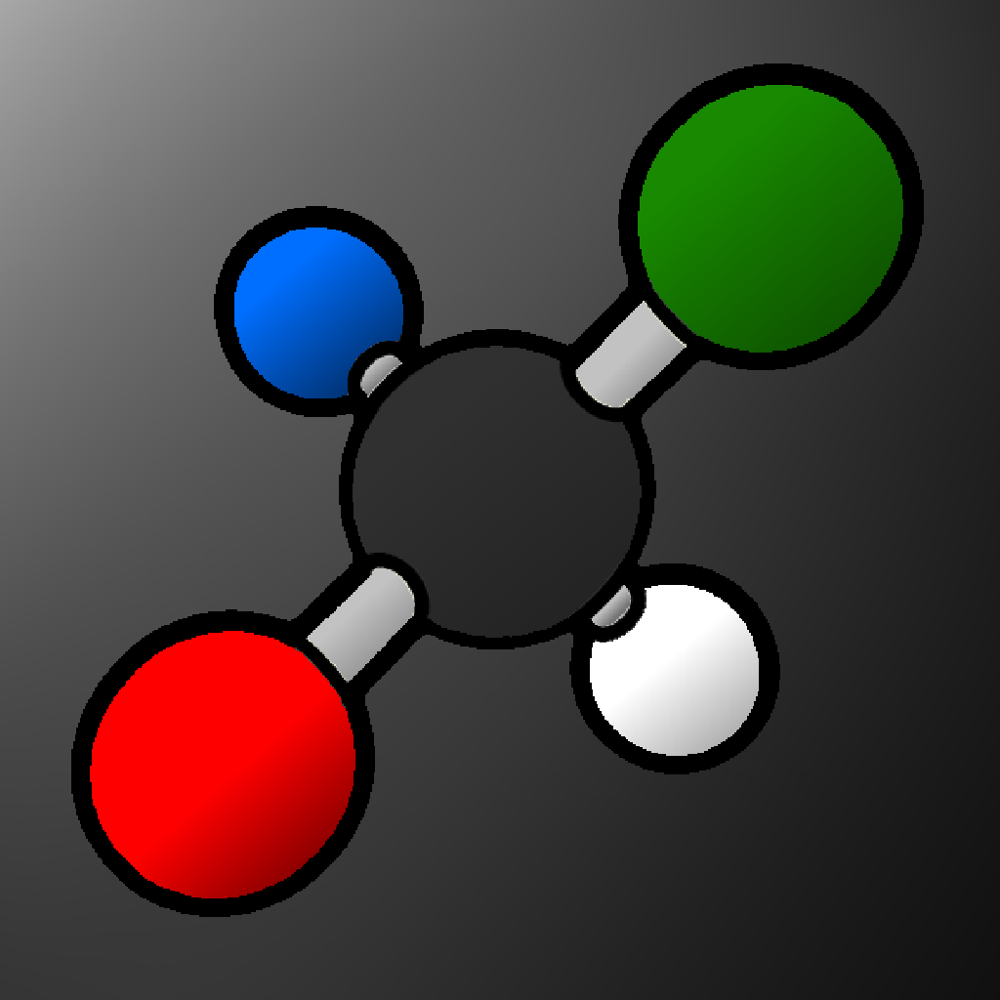
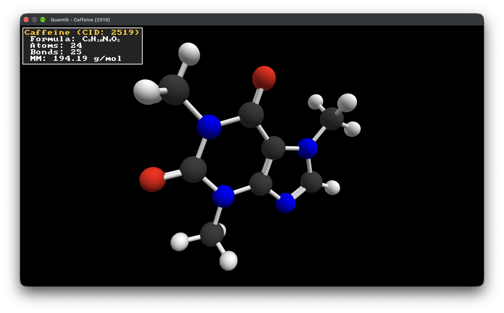
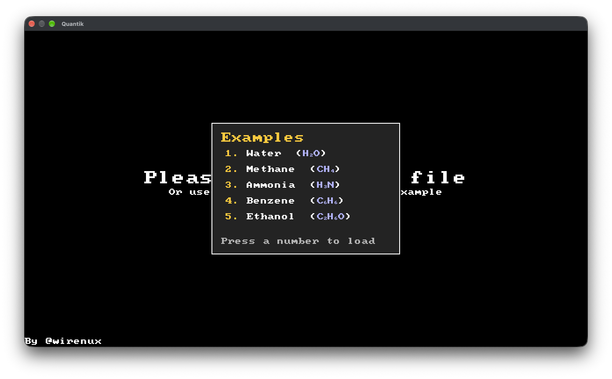
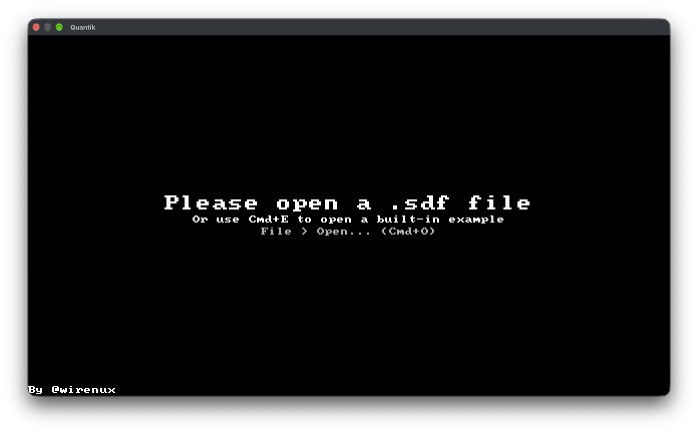

<p align="center">
    
    <h1 align="center">Quantik</h1>
</p>

<p align="center">
    
    
    
    
    
    
    <br />
    A Molecule 3D Viewer built in Rust with no 3D engine :D
</p>

---

## Table of Content
- [Table of Content](#table-of-content)
- [Why Quantik even exist ( °ヮ° ) ?](#why-quantik-even-exist--ヮ--)
- [Images](#images)
- [Built with...](#built-with)
- [Installation \& Quick Start](#installation--quick-start)
- [Stardance Devlogs ᕙ( •̀ ᗜ •́ )ᕗ](#stardance-devlogs-ᕙ-̀-ᗜ-́-ᕗ)
- [Development](#development)
  - [Dependencies](#dependencies)
  - [Building Quantik from source](#building-quantik-from-source)
- [Boring Stuff](#boring-stuff)
  - [Use of AI](#use-of-ai)
  - [Credits](#credits)
  - [Platform notes](#platform-notes)
  - [Fun fact](#fun-fact)
  - [License](#license)


## Why Quantik even exist ( °ヮ° ) ?

Quantik does exist for multiple reason : I wanted to create a 3D molecule viewer that my teacher could use in class; also because I wanted to learn how 3D work in depth; and finally to use it my self with homework (because most software are only on windows and I use a mac)

## Images

<table>
  <tr>
    <td clospan="4" align="center">
      <br>
      <sub><b>3D Molecule (Caffeine)</b></sub>
    </td>
    <td colspan="4" align="center">
      <br>
      <sub><b>Example Menu</b></sub>
    </td>
  </tr>

  <tr>
    <td colspan="2" align="center">
      <br>
      <sub><b>Home menu</b></sub>
    </td>
  </tr>
</table>

<!-- ## Core Features ( ദ്ദി ˙ᗜ˙ )

### Editor

* **Pixel Painting**: Use the mouse to paint ദ്ദി(˵ •̀ ᴗ - ˵ ) ✧
* **Bucket Fill**: A classic flood-fill tool
* **Transform Tools**: You can flip, rotate, move the active tile
* **Live Previews**: A little 4x4 grid to preview the active tile in a pattern (e.g: a background)
* **Virtualized Tile List**: Only the visible tiles in the sidebar are rendered each frame
* **Cached Texture Rendering**: Tile textures are cached and only rebuilt when a tile is modified

### Project Management

* **Multi-Tile Support**: You can draw up to 128 tiles per project file (you can scroll the list on the right of the screen to change tile)
* **Undo/Redo**: Each action is store in a stack, so you are able to undo or redo an action !
* **Copy/Paste/Cut**: Duplicate or move tile data between slots (in the same project)
* **File Format**: Each project is saved in `.dmgtile` (JSON), storing only the modified tiles while preseving the tiles ID
* **Keyboard Shortcut**: Full Cmd/Ctrl support for New Project, Open, Save, Undo, Redo, etc... Even the tools have there own shortcut

### Export

* **`.bin` Export**: Exports all the modified tiles into the Gameboy's native 2bpp format
* **`.c` Export**: Exports all the modified tiles as a C array, with the array name derived from the filename (Can be used with [GBDK](https://gbdk.org))
* **Selective export**: Only the modified tiles are written out -->

## Built with...

This project was built to help me learn Rust while creating a usefull Application. Here is what I have used:

* [Rust](https://rust-lang.org/): for the whole app! `ദ്ദി(˵ •̀ ᴗ - ˵ ) ✧`
* [`gpui`](https://gpui.rs): for the cross-platform UI
* [`serde`](https://serde.rs/) + [`serde_json`](https://docs.rs/serde_json/): for the `.dmgtile` file
* [`rfd`](https://github.com/PolyMeilex/rfd): for native file dialogs

## Installation & Quick Start

The easiest way to get **Quantik** is to go to the [Github Release](https://github.com/wirenux/Quantik/releases) and get the latest version `( ദ്ദി ˙ᗜ˙ )`. (Otherwise you can build the project from source on your own here: [Developement](#developement))

1. Launch DMGTile, use `File > New` (or `Cmd/Ctrl+N`) to start the project
2. Select a tile from the tile list. And then paint !
3. `File > Export As` to write out `.bin` or `.c` for your game !

`ദ്ദി(˵ •̀ ᴗ - ˵ ) ✧`

## Stardance Devlogs ᕙ( •̀ ᗜ •́ )ᕗ

On [Stardance](https://stardance.hackclub.com/) you can watch the full development process via all the devlogs I've created here: [Quantik Devlogs](https://stardance.hackclub.com/projects/65521)

## Development

> [!IMPORTANT]
> You must have [Rust](https://rust-lang.org/) and [Cargo](https://doc.rust-lang.org/cargo/) installed on your computer

### Dependencies

* [`font8x8`](https://crates.io/crates/font8x8/)
* [`glam`](https://crates.io/crates/glam/)
* [`minifb`](https://crates.io/crates/minifb/)
* [`rayon`](https://crates.io/crates/rayon/)
* [`rfd`](https://github.com/PolyMeilex/rfd)

### Building Quantik from source

* Clone the repository with

```bash
git clone https://github.com/wirenux/Quantik.git
cd Quantik
```

* Then build and run with:

```bash
cargo build --release
./target/release/Quantik
```

## Boring Stuff

### Use of AI

* Brainstorming
* Help with understanding 3D maths and hard 3D info

### Credits

This project is created by [@wirenux](https://github.com/wirenux) in [Rust](https://rust-lang.org/), using [minifb](https://crates.io/crates/minifb/).


Logo by [@wirenux](https://github.com/wirenux) with the help of [@c3a5m7](https://youtube.com/@c3a5m7)

### Platform notes

* **macOS**: uses the native menu bar
* **Windows**: shows an in-window menu bar

### Fun fact

* 

### License

This project is released under the [MIT License](./LICENSE)