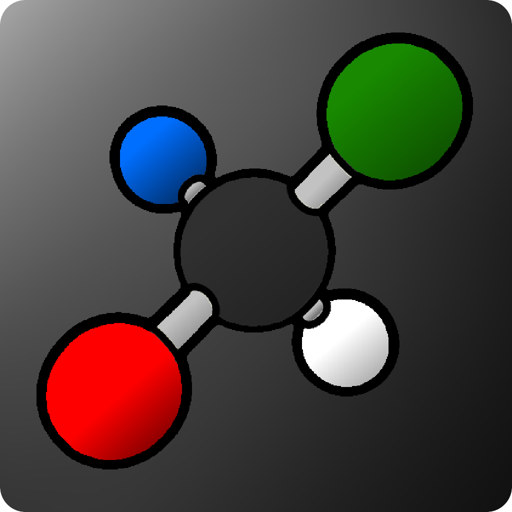

<p align="center">
    
    <h1 align="center">Quantik</h1>
</p>

<p align="center">
    
    
    
    
    
    <br />
    A Molecule 3D Viewer built in Rust with no 3D engine :D
</p>

---

## Table of Content
- [Table of Content](#table-of-content)
- [Why Quantik even exist ( °ヮ° ) ?](#why-quantik-even-exist--ヮ--)
- [Images](#images)
- [Core Features ( ദ്ദി ˙ᗜ˙ )](#core-features--ദ്ദി-ᗜ-)
  - [Viewer](#viewer)
  - [Software Renderer ദ്ദി(˵ •̀ ᴗ - ˵ )](#software-renderer-ദ്ദി-̀-ᴗ----)
  - [Molecule Loading](#molecule-loading)
  - [Controls](#controls)
- [Built with...](#built-with)
- [Installation \& Quick Start](#installation--quick-start)
- [Stardance Devlogs ᕙ( •̀ ᗜ •́ )ᕗ](#stardance-devlogs-ᕙ-̀-ᗜ-́-ᕗ)
- [Development](#development)
  - [Dependencies](#dependencies)
  - [Building Quantik from source](#building-quantik-from-source)
- [Boring Stuff](#boring-stuff)
  - [Use of AI](#use-of-ai)
  - [Credits](#credits)
  - [Platform notes](#platform-notes)
  - [Fun fact](#fun-fact)
  - [License](#license)


## Why Quantik even exist ( °ヮ° ) ?

Quantik does exist for multiple reason : I wanted to create a 3D molecule viewer that my teacher could use in class; also because I wanted to learn how 3D work in depth; and finally to use it my self with homework (because most software are only on windows and I use a mac)

## Images

<table>
  <tr>
    <td align="center">
      <br>
      <sub><b>3D Molecule (Caffeine)</b></sub>
    </td>
    <td colspan="4" align="center">
      <br>
      <sub><b>Example Menu</b></sub>
    </td>
  </tr>

  <tr>
    <td colspan="2" align="center">
      <br>
      <sub><b>Home menu</b></sub>
    </td>
  </tr>
</table>

## Core Features ( ദ്ദി ˙ᗜ˙ )

### Viewer

* **Atoms and Bound Rendering**: Atoms are drawn as spheres and bonds as cylinders (double and triple bonds are drawn as 2 or 3 parallel cylinders)
* **CPK Colors & Real Atomic Radii**: Each element has its own color and a size based on its van der Waals radius
* **Orbit Camera**: Rotate, pan and zoom around the molecule with the mouse or the keyboard
* **Auto Rotate**: Press `Space` to let the molecule spin by itself (`-` / `=` to change the speed)
* **Hover Tooltip**: Hover an atom to see its name, symbol, index, radius and molar mass
* **Info Panel**: Name, formula, number of atoms, number of bonds and total molar mass

### Software Renderer ദ്ദി(˵ •̀ ᴗ - ˵ )

* **No GPU, no engine**: Everything is rasterized on the CPU
* **Depth Buffer**: So atoms and bonds hide each other properly
* **Lighting**: A key light + a fill light, computed per vertex and interpolated across each triangle
* **Back-face Culling**: Triangles that look away from the camera are not rendered
* **SSAA Anti-aliasing**: Low quality (1x) while you move the camera for speed, then 3x anti-aliasing when you stop
* **Redraw On Demand**: The scene is only re-rendered when something changed (camera, hover, resize, new molecule)
* **Atom ID Buffer**: Each pixel remembers which atom drew it, that's how hovering works

### Molecule Loading

* **`.sdf` Files**: Open any SDF file (`.sdf` or `.txt`) with a native file dialog
* **Built-in Examples**: Water, Methane, Ammonia, Benzene and Ethanol are built-in (so no file is needed)
* **Auto Framing**: The molecule is centered and the camera distance is set from its size
* **Known Names**: Some PubChem CIDs are recognised (Water, Caffeine, Cocaine, Vitamin C...), the others are shown as `CID <number>`

### Controls

| Action | Input |
| --- | --- |
| Rotate | Left mouse drag / Arrow keys |
| Pan | Right mouse drag |
| Zoom | Scroll wheel / `W` `S` |
| Auto rotate | `Space` (speed: `-` / `=`) |
| Reset camera | `R` |
| Open file | `Cmd/Ctrl + O` |
| Example list | `Cmd/Ctrl + E` then `1`-`9` to load |
| Close list / Quit | `Esc` |

## Built with...

This project was built to help me learn Rust while creating a useful Application. Here is what I have used:

* [Rust](https://rust-lang.org/): for the whole app! `ദ്ദി(˵ •̀ ᴗ - ˵ ) ✧`
* [`minifb`](https://crates.io/crates/minifb/): for the window, the menus and the input
* [`glam`](https://crates.io/crates/glam/): for the vector and matrix maths
* [`rayon`](https://crates.io/crates/rayon/): for the parallel anti-aliasing resolve
* [`font8x8`](https://crates.io/crates/font8x8/): for the bitmap font used by the UI
* [`rfd`](https://github.com/PolyMeilex/rfd): for native file dialogs

## Installation & Quick Start

The easiest way to get **Quantik** is to go to the [Github Release](https://github.com/wirenux/Quantik/releases) and get the latest version `( ദ്ദി ˙ᗜ˙ )`. (Otherwise you can build the project from source on your own here: [Developement](#developement))

1. Launch Quantik. You will see the home menu
2. Use `Examples > Show list` (or `Cmd/Ctrl+E`) then press `1`-`9` to load a built-in molecule or `File > Open...` (or `Cmd/Ctrl+O`) to load an `.sdf` file
3. Drag with the left mouse button to rotate, right button to pan, scroll to zoom, and hover an atom to see its info !

`ദ്ദി(˵ •̀ ᴗ - ˵ ) ✧`

## Stardance Devlogs ᕙ( •̀ ᗜ •́ )ᕗ

On [Stardance](https://stardance.hackclub.com/) you can watch the full development process via all the devlogs I've created here: [Quantik Devlogs](https://stardance.hackclub.com/projects/65521)

## Development

> [!IMPORTANT]
> You must have [Rust](https://rust-lang.org/) and [Cargo](https://doc.rust-lang.org/cargo/) installed on your computer

### Dependencies

* [`font8x8`](https://crates.io/crates/font8x8/)
* [`glam`](https://crates.io/crates/glam/)
* [`minifb`](https://crates.io/crates/minifb/)
* [`rayon`](https://crates.io/crates/rayon/)
* [`rfd`](https://github.com/PolyMeilex/rfd)

### Building Quantik from source

* Clone the repository with

```bash
git clone https://github.com/wirenux/Quantik.git
cd Quantik
```

* Then build and run with:

```bash
cargo build --release
./target/release/Quantik
```

## Boring Stuff

### Use of AI

* Brainstorming
* Help with understanding 3D maths and hard 3D info

### Credits

This project is created by [@wirenux](https://github.com/wirenux) in [Rust](https://rust-lang.org/), using [minifb](https://crates.io/crates/minifb/).

Logo by [@wirenux](https://github.com/wirenux) with the help of [@c3a5m7](https://youtube.com/@c3a5m7)

### Platform notes

* **macOS**: uses the native menu bar
* **Windows**: shows an in-window menu bar

### Fun fact

* When you press `Space` the molecule rotate (in reality it's the camera) and it also help me to know how much FPS i was getting (since i calculate FPS when the framebuffer/screen is changing)

* I choose the name Quantik because Atomik was already taken

### License

This project is released under the [MIT License](./LICENSE)